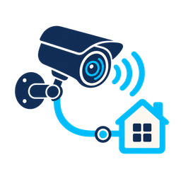

# RTSPX Camera Bridge for Home Assistant



[](https://github.com/john-penntech/kitchen-rtspx-home-assistant/actions/workflows/test.yml)
[](https://github.com/john-penntech/kitchen-rtspx-home-assistant/actions/workflows/hacs.yml)
[](https://github.com/john-penntech/kitchen-rtspx-home-assistant/actions/workflows/hassfest.yml)

`kitchen_rtspx` hands local `rtspx://` camera sources directly to Home
Assistant's built-in go2rtc stream provider. Version 1.1.4 adds native HLS
fallback through that server's existing loopback RTSP listener, with an
on-demand H.264/AAC compatibility stream capped at 1280 pixels wide.
This lets browsers without an HEVC decoder display an H.265 camera. It prevents
the `Protocol not found` failure caused by passing an RTSPX URL to PyAV when
WebRTC is unavailable. It requires Home Assistant 2026.8.1 or later with its
HA-managed go2rtc server; an external go2rtc server is outside this fallback's
supported configuration. No extra proxy, listener, or network permission is
introduced. Camera credentials stay behind Home Assistant's normal access path.

Version 1.1.1 adds automatic,
credential-safe migration from the legacy YAML platform to normal GUI config
entries, building on the HACS distribution, protected reconfiguration, and
redacted diagnostics introduced in v1.1.0.

This integration is intended for local streams such as secure UniFi Protect
links. It deliberately rejects non-RTSPX URLs and any `enableSrtp` query option,
which would bypass the intended native go2rtc path.

## Install with HACS

1. Install and configure [HACS](https://www.hacs.xyz/docs/use/download/download/).
2. Open HACS, select the three-dot menu, then **Custom repositories**.
3. Add `https://github.com/john-penntech/kitchen-rtspx-home-assistant` as an
   **Integration** repository.
4. Search for **RTSPX Camera Bridge** and download the latest release. Follow
   [Update with HACS](#update-with-hacs) to back up and apply the update.

[](https://my.home-assistant.io/redirect/hacs_repository/?owner=john-penntech&repository=kitchen-rtspx-home-assistant&category=integration)

## Add cameras in the GUI

In Home Assistant, open **Settings > Devices & services > Add integration**,
search for **RTSPX Camera Bridge**, and enter:

- **Camera name**: the display name.
- **Camera ID**: a permanent lowercase identifier, such as `patio_camera`.
- **RTSPX stream URL**: the full credential-bearing `rtspx://` source. The field
  is masked, and diagnostics redact it completely.

Repeat the flow for each camera. Use the integration's **Configure** action to
change a camera name or URL later.

## Update with HACS

1. Create a Home Assistant backup before downloading an update.
2. Open **Settings > System > Updates**, select **RTSPX Camera Bridge**, review
   the release notes, and select **Update**. HACS downloads the new files.
3. Download any other integration updates you want to apply, then restart Home
   Assistant **once**, when a brief interruption to cameras, automations, and
   voice control is convenient. Open **Settings > System**, select the power
   menu, then **Restart Home Assistant**. If you maintain YAML configuration,
   validate it before restarting and resolve any errors first.
4. When Home Assistant is ready, reopen your camera dashboard and confirm that
   live video moves. A thumbnail alone does not verify playback.

A restart loads the updated Python integration code. Reloading the integration
or refreshing your browser does not replace that code. This integration does
not restart Home Assistant automatically; HACS owns the download and
pending-restart status. Your camera settings and entity IDs are preserved.

If playback regresses, use HACS **Redownload** to select the previous release,
then restart and verify live video. See [ROLLBACK.md](ROLLBACK.md) for recovery.

### Missing image in HACS

The integration includes its camera icon in `brand/icon.png`. Some HACS
screens still request images from the central brands service and show
"icon not available" for custom integrations. Our release notes include the
image directly. The small update-header image remains subject to the
[upstream HACS limitation](https://github.com/hacs/integration/issues/5402);
repeatedly restarting or reinstalling this integration will not repair it.
See [the presentation review](docs/hacs-update-experience.md) for details.

## Migrate from the v1.0.0 YAML platform

Version 1.1.1 imports every legacy YAML camera as a normal config entry during
the first restart. The import preserves the camera name, stable `unique_id`,
credential-bearing stream URL, and existing entity ID without displaying or
logging the URL.

1. Back up `/config`, install v1.1.1, and restart while keeping the YAML.
2. Verify that each camera appears under **Settings > Devices & services >
   RTSPX Camera Bridge** and that existing dashboard entity IDs still work.
3. Remove the entire `platform: kitchen_rtspx` YAML block.
4. Run `ha core check`, restart, and verify the same config entries and entity
   IDs again.

Leaving the YAML in place is safe during verification: later restarts detect
the already-imported Camera IDs and do not create duplicates or overwrite GUI
reconfiguration. Never paste a stream URL into an issue, log, screenshot, or
Git repository.

## Manual installation

Copy `custom_components/kitchen_rtspx` to Home Assistant's
`/config/custom_components/` directory, run `ha core check`, and restart. HACS
is recommended because it gives users a normal update path.

## Verification and support

```text
python -m compileall -q custom_components tests
python -m unittest discover -s tests -v
```

Repository checks validate the manifest, HACS layout, translations, config
entry and legacy setup paths, URL policy, and absence of high-risk execution or
write primitives. See [ROLLBACK.md](ROLLBACK.md),
[PROVENANCE.md](PROVENANCE.md), and the
[architecture decision](docs/adr/0001-native-go2rtc-rtspx-camera-platform.md).

## Upgrade to 1.1.4

Back up the component directory and entity/config-entry registries, install the
updated component, run `ha core check`, then restart Home Assistant. Confirm
both decoded video and advancing playback on the dashboard. A fresh thumbnail
alone does not verify live video. Ensure the dashboard entity belongs to
`kitchen_rtspx`, rather than an older Generic Camera entity with a similar name.
For rollback, restore the previous component directory and restart after
configuration validation; use the supported entity settings UI to reverse an
entity-ID reassignment. Never restore registry storage into a running instance.

This is an independent local integration, not an official Home Assistant,
HACS, go2rtc, or Ubiquiti project. Report bugs through
[GitHub Issues](https://github.com/john-penntech/kitchen-rtspx-home-assistant/issues).
